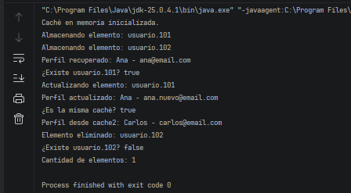

# Ejercicio 4: Servicio de Caché en Memoria

## Descripción

Este ejercicio implementa el patrón de diseño **Singleton** en Java para administrar una caché compartida en memoria.

La clase `MemoryCache` permite almacenar, recuperar, actualizar y eliminar datos mediante claves únicas, evitando mantener múltiples repositorios independientes dentro de la aplicación.

## Objetivos

- Aplicar Singleton para compartir una única caché.
- Impedir la creación de instancias adicionales mediante un constructor privado.
- Implementar inicialización perezosa (*Lazy Initialization*).
- Almacenar y recuperar datos mediante claves.
- Verificar la existencia de elementos y actualizar sus valores.
- Proteger la estructura interna frente a modificaciones externas.
- Sincronizar las operaciones de acceso a la caché.

## Implementación del patrón Singleton

La clase `MemoryCache` utiliza los siguientes elementos:

- **Instancia estática:** mantiene la referencia al único objeto de caché.
- **Constructor privado:** impide crear instancias directamente desde otras clases.
- **Método `getInstance()`:** crea la caché cuando se solicita por primera vez y devuelve siempre la misma instancia.
- **Método `put()`:** almacena elementos nuevos o actualiza los existentes.
- **Método `get()`:** recupera un valor mediante su clave.
- **Método `containsKey()`:** comprueba si una clave existe.
- **Método `remove()`:** elimina un elemento.
- **Método `size()`:** devuelve la cantidad de elementos almacenados.
- **Métodos sincronizados:** coordinan el acceso concurrente a los datos compartidos.

## Propósito de la clase MemoryCache

La clase `MemoryCache` se creó para conservar temporalmente datos que la aplicación necesita consultar con frecuencia. De esta manera, los componentes pueden compartir los mismos datos sin mantener copias independientes de la caché.

La estructura `HashMap` permanece encapsulada dentro de la clase, por lo que otras clases no pueden modificarla directamente. Los cambios deben realizarse mediante los métodos públicos que ofrece el Singleton.

En este ejercicio, los datos se almacenan únicamente en memoria: se pierden cuando termina el proceso de la aplicación. Además, aunque la caché es compartida y 
sus operaciones están sincronizadas, todavía no se implementa un límite máximo de capacidad ni un mecanismo de expulsión automática de elementos.

## Concepto clave
put() sirve tanto para agregar como para actualizar. Si la clave ya existe, HashMap reemplaza su valor anterior; si no existe, crea una nueva entrada.

## Resultado

## Conclusión

Este ejercicio demuestra cómo Singleton permite administrar un estado dinámico compartido entre diferentes componentes. 
La inicialización perezosa evita crear la caché hasta que sea necesaria, mientras que la sincronización ayuda a coordinar las operaciones concurrentes.